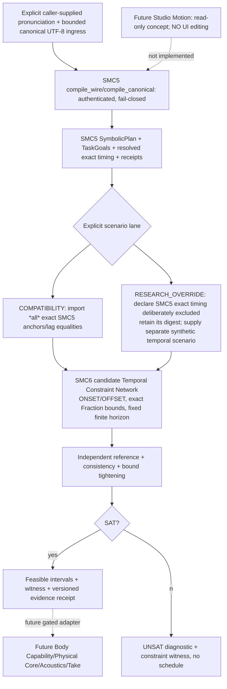
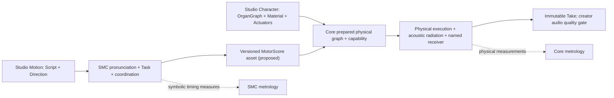

# SMC-6 A0 SYSTEM — time-coordination research architecture

**Status 2026-10-27 JST:** DESIGN_REFINEMENT_ONLY / NOT_PREREG_FROZEN / NO_IMPLEMENTATION / SCIENCE_NOT_ADOPTED / NO_MAIN_MERGE. Owner [Issue #219](https://github.com/ryonakayama234/morphoacoustics/issues/219). Parent SMC5 Draft [#211](https://github.com/ryonakayama234/morphoacoustics/pull/211) SHA `894d2f0d68169e7f794d78be729057b3b31d6017`, itself stacked on unmerged SMC4-BR #189. The historical rejected #180 remains untouched.

## The creative and scientific question
Can a creator's externally selected pronunciation hypothesis and a reusable body-neutral Task inventory produce a **verifiable temporal feasible region** and a distinguishable example schedule, without asserting body execution, phonetic naturalness, or acoustic output? Later Studio Motion may edit script/direction and inspect score; Core/Character alone determines realizability and resulting sound.

The previous "coarticulation = increased overlap" shortcut is invalid. Overlap is a computable timing property, not evidence of a natural phonetic gesture, real articulator trajectory or perceived speech quality.

## Separate four questions
1. Hard constraint SAT/UNSAT: what relative event times are allowed?
2. Schedule selection: which of many legal schedules is selected, by what *explicit* policy?
3. Activation semantics: what do the selected ONSET/OFFSET markers mean? Here: only **symbolic Task-active intervals**; not muscle stimulation, organ pose, constriction formation, audible phoneme or physical state-contiguity.
4. Physical realization: body-dependent inverse controller, actuator allocation, biomechanics, airflow/acoustics and listening belong to **other gates**.

## Two separate research lanes

**Critical compatibility rule:** SMC5's exact ONSET/OFFSET anchors and `CouplingConstraint.lag_s` are immutable equalities. Merely adding a range around them DOES NOT free the exact events. The compatibility lane proves degeneracy to SMC5 timing. The research-override lane **explicitly declares a different experimental timing hypothesis**, so its output cannot be labeled the original SMC5 candidate or an exact replay. At a later adoption gate, decide whether mapper and timing resolution should be separated through a new reviewed contract.

## First mathematical family: Simple Temporal Network (STN)
Let each task occurrence `i` have two event variables `s_i` (start) and `e_i` (end), exact rational seconds. One hard relation between events `t_i,t_j`:
\[
L_{ij}\le t_j-t_i\le U_{ij}.
\]
These become difference edges `i→j:U`, `j→i:-L`. A negative cycle means UNSAT. Include local origin `t_0=0`, finite bounded horizon `0≤s_i<e_i≤T`, explicit strictly positive minimum duration (the pilot requires `duration ≥ epsilon>0` with finite rational epsilon; a generic open strict inequality alone is not an STN closed bound). For a grounded finite network, compute supported event time windows and an explicitly documented deterministic **witness**. Windows are not an activation trajectory and one witness is not a preferred natural score.

- The exact event-equality sublanguage must be represented by `L=U`; compatibility lane never mutates SMC5.
- The pilot is conjunctive STN only. Disjunction, conditional scenarios, arbitrary scalar nonlinear relations, phonological phase attractors and learned scheduling are not implied tractable.
- A policy such as "earliest feasible witness" is a *mathematical deterministic tie-breaker*, not evidence of natural gesture timing.
- "Preferred overlap" is a soft objective distinct from hard validity. Do **not** encode preference as a hard constraint without an explicit policy. No preference optimization in first pilot.
- Symbolic goal **value intervals** in SMC5 TaskGoal (`lower/upper`) are NOT event timing bounds. Keep their identity separate.

## Relative phase is not relative onset fraction
Diagnostic `r_ij=(s_j-s_i)/(e_i-s_i)` is a **dimensionless onset fraction** where duration is positive. It is *not* oscillator phase (radians) or TaDA coupling phase; converting to `2πr` would assert periodic oscillator assumptions absent here. True coupled planning oscillator experiments require a separate model, empirical reference and gate. TaDA and task dynamics are scientific antecedents, not evidence this proposed compiler reproduces humans.

## Identity, failure, and trust boundaries
- Keep existing `SymbolicPlan`, `TaskGoal`, `CompileResult` unchanged. SMC6 sidecar references original canonical request SHA, SMC5 plan and candidate digests, Task IDs, TaskGoal evidence and **original exact timing SHA**; a new scenario/solution digest is never substituted for SMC5's digest.
- Inputs must derive from revalidated canonical bytes. Do not accept forged mutable plan objects as trusted input. All added constraint IDs and scenario versions recorded; refuse unknown task/event, duplicate conflicting declaration, missing/ambiguous study provenance, inconsistent rational values, and unbounded/underdetermined output where a bounded witness is demanded.
- Fail-closed categories distinguish INPUT_INVALID / UNSUPPORTED_CONSTRAINT_CLASS / TEMPORAL_UNSAT / UNDERDETERMINED / INSTRUMENT_ERROR. An underdetermined but SAT network may return envelopes but **never** imply a unique/natural score.
- SMC6 has no morphology/organ/actuator/phonation/pressure/F0/solver or waveform fields, and cannot return Core `INFEASIBLE`.

## Future architecture only (not implemented)

Studio Workspace V2 layout/slots are frozen; no SMC6 Studio UI proposal or modification. [ADR](https://github.com/ryonakayama234/morphoacoustics-studio/blob/main/docs/product/STUDIO_WORKSPACE_V2_DECISION.md). Core scientific program [#199](https://github.com/ryonakayama234/morphoacoustics/issues/199).

## References
- Dechter, Meiri, Pearl (1991), *Temporal constraint networks*, DOI 10.1016/0004-3702(91)90006-6 — tractable STP vs more general temporal CSP.
- Saltzman, Nam, Krivokapic, Goldstein (2008), *A task-dynamic toolkit for modeling the effects of prosodic structure on articulation* (ISCA).
- *A procedure for estimating gestural scores from speech acoustics*, PMC3528686 — TaDA/coupled gestures, physical realization distinct from score.
- Krause & Kawamoto (2020), DOI 10.1111/lnc3.12373 — evidence that online feedback can reshape articulation, a limitation of fixed feedforward score models.
