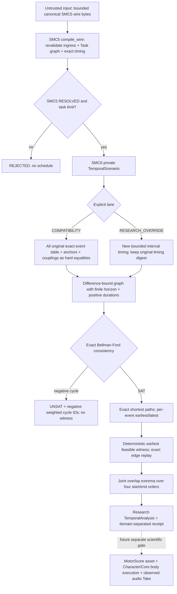
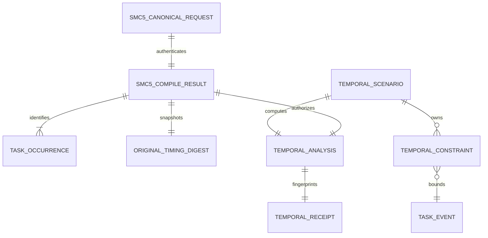
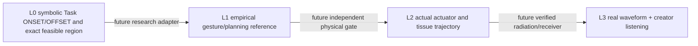

# SMC-6 Gate B — as-built SYSTEM / DATA / measurement trace

**Research-only, not a public motor instruction set**; see [protocol](SMC6_GATE_A_PROTOCOL.md), [results](SMC6_GATE_B_RESULTS.md), A0 [SYSTEM](SMC6_A0_SYSTEM.md), [DATA](SMC6_A0_DATA.md), [METROLOGY](SMC6_A0_METROLOGY.md), [EXPERIMENT](SMC6_A0_EXPERIMENT.md). This additive record does not revise original design-only documents or authorize Core/Studio changes.

## System: actual Python path

No sound, body state, performance adaptation or GUI can be produced from this module. `__init__.py`, SMC3/5 contracts, parent physics, Studio and public performance-schema remain unchanged.

## Data: research-only typed objects

- `TemporalConstraint`: finite exact `Fraction` lower/upper time difference between `(task_id,Event)` endpoints or origin. Unique user-defined provenance ID; duplicate equivalent constraints **with distinct IDs are preserved**.
- `TemporalScenario`: study identity, COMPATIBILITY/RESEARCH_OVERRIDE lane, finite local exact horizon, minimum positive duration, extra constraints, explicit replacement policy/reason for override. Model does **not** have muscle/stiffness, organ ports or waveform data.
- `TemporalAnalysis`: exact `SAT_UNIQUE`/`SAT_NONUNIQUE`/`UNSAT`/`REJECTED`/`INDETERMINATE`; each event (earliest, latest, one mathematical witness); each distinct task pair (minimum feasible overlap, maximum feasible overlap, witness overlap). UNSAT exposes actually extracted negative cycle constraint IDs and exact negative edge-weight sum.
- `TemporalReceipt`: original canonical-request hash, SMC5 `plan_digest` and `candidate_digest`, original exact timing digest, new scenario digest, optional successful witness digest. The new digest is **not** a synonym or a mutation of the original.
- Only `compile_wire(raw)` constructs SMC5 authentication, not arbitrary caller-supplied `CompileResult`. SMC5 canonicalization and goal identity remain the source of truth.

## Mathematical observation vs actual motor/acoustic observation

**Actual L0 measurands implemented/tested:** satisfiability, zero hard-residual checks, exact earliest/latest, mathematical underdetermination, unique Task identity, witness overlap, feasible-set overlap extrema, constraint sensitivity, contradiction cycle weight/IDs, replay digest invariance and fail-closed rejection. `[earliest,latest]` is mathematical possibility under chosen assumptions, **not uncertainty from a human measurement instrument**.

**Future metrology:** L1 needs precisely annotated vocal-tract movement and onset segmentation uncertainty. L2 needs a clocked Core physical trace of attempted Task, actuator, state/contact, pressure/flow and feasible/infeasible outcome. L3 needs actual receiver/radiation semantics and listening with independent intelligibility/voice-like/character utility. Numerically correct timing by itself cannot establish coarticulation, production phonetics or perceptual naturalness.

## Studio relationship (design-only)
The accepted Studio V2 [Workspace ADR](https://github.com/ryonakayama234/morphoacoustics-studio/blob/main/docs/product/STUDIO_WORKSPACE_V2_DECISION.md) reserves the `motion.canvas` for a future Script/Direction/MotorScore timeline and the `take.transport` for audibly verified Takes. This SMC-6 research makes **zero** Studio modifications. Model output is mathematical metadata until a separate adopted MotorScore adapter/physical execution gate exists.

## Exact scope and important limitations
STN handles **conjunctions of hard difference intervals only**. It does not optimize soft preferences or true coupled-oscillator phase, nor does the earliest-witness choice imply speech optimality. No morphology-dependent motor realization or `INFEASIBLE` physical verdict can be issued. Fixed per-scenario 0..10s range and 12 task/96 constraint limits are deliberately small research guardrails, not claims of complete production requirements.
