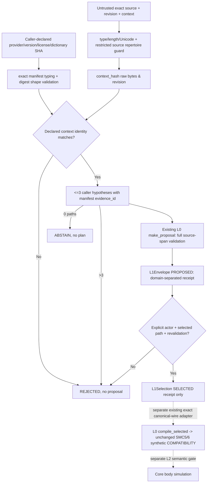

# SMC-7 L1-R Gate B — as-built research evidence boundary (2026-10-29)

**Research module:** `src/morphoacoustics_smc/l1r_evidence.py` on Draft #243. This is **NOT** Japanese G2P, natural timing, physical motion, sound synthesis, a public MotorScore ABI, or a Studio feature.

## Implemented data flow

### Objects
- `EvidenceManifest(provider_id, provider_version, dictionary_digest, policy_revision, license_id, context_digest)`: strict original strings and 64-character SHA-256 **shape**. Metadata can be declared by a dishonest caller; it is **not** an authenticated registry attestation, a data license approval, or pronunciation truth.
- `L1Envelope(status, code, context_digest, manifest_identity, envelope_id, proposal)`: produced only by `make_l1_envelope`. Candidate-set ID binds original L0 proposal digest plus context and declared provider/policy/dictionary identity. Exact source/revision is bound through the L0 proposal digest. No SMC5/6 result field.
- `L1Selection(status, code, selected_path_id, selection_id)`: `select_l1_path` re-checks every input with L0 and L1 validators, and rejects malformed, stale, mismatched or unselected data. Actor is a self-declared identifier, not an authenticated user credential. A selected receipt **does not** by itself compile synthetic Tasks.
- `ReadingMetrics(n, hits_at_1, hits_at_2, hits_at_3, candidate_total, recall_at_1/2/3, burden)`: exact Fraction ratios from independent caller-supplied **full-katakana-utterance** reference/candidate sets. This generic calculation alone does not establish dataset independence or statistical confidence; real corpus accession is separate #244.

### Explicit constraints
- Input source: 1–256 raw Unicode codepoints, UTF-8 <=2048 bytes, no surrogate. Supported *research subset only*: basic CJK Unified ideographs U+4E00..9FFF, hiragana U+3041..3096, katakana U+30A1..30FA, exactly `SPACE TAB LF 、。！？…` silent L0 separators. No NFKC, emoji, ASCII, standalone long mark U+30FC, middle dot, iteration mark or unsupported punctuation; reject rather than invent reading alignment.
- Context: at most 512 original codepoints/2048 bytes, exact `ja-JP` profile and source revision, strict types before caller-defined comparison, no surrogate.
- Manifest: pinned declared version/identity and lowercase 64-hexdigit SHA-256 syntax. No online resolution/authentication or actual dictionary download here.
- Candidate path: 0..3; zero -> `ABSTAIN`; over 3 -> `CANDIDATE_LIMIT` with no usable output. Every nonzero complete hypothesis has manifest content identity and is revalidated by existing L0 `make_proposal`.
- Selection: explicit registered actor *name* and exact member path; checks stale source/context/provider/candidate set; no implicit best candidate, time, TaskLexicon, Core, voice or Take.
- Metric: 1..10000 independent instances, 1..8 allowed references each, 0..3 unique candidate strings; prohibit duplicates, invalid Unicode/types, partial output; returns mathematical ratios only. No bootstrap or prediction is performed by this module.

### What this software gate cannot prove
This is a foundation to **measure** contextual Japanese pronunciation research, not the context-aware generator itself. The first source SHA `38a4c7e` passed CI but failed independent review on unsupported repertoire and custom comparison; new preregistered tests exposed these bugs at `c85057d`. Repaired code SHA `f2ff1e0` must be separately reviewed before any software gate decision. The 880-case held-out language study remains unstarted; no gold, dictionary binaries or model are installed/frozen. Retain the original P2 evidence.

See [method freeze](SMC7_L1R_GATE_A_PROTOCOL.md), [adversarial amendment](SMC7_L1R_GATE_B_AMENDMENT_01.md), [L0 trust repair](SMC7_GATE_B_DECISIONS.md), owner #242, evidence accession #244, PR #243.
