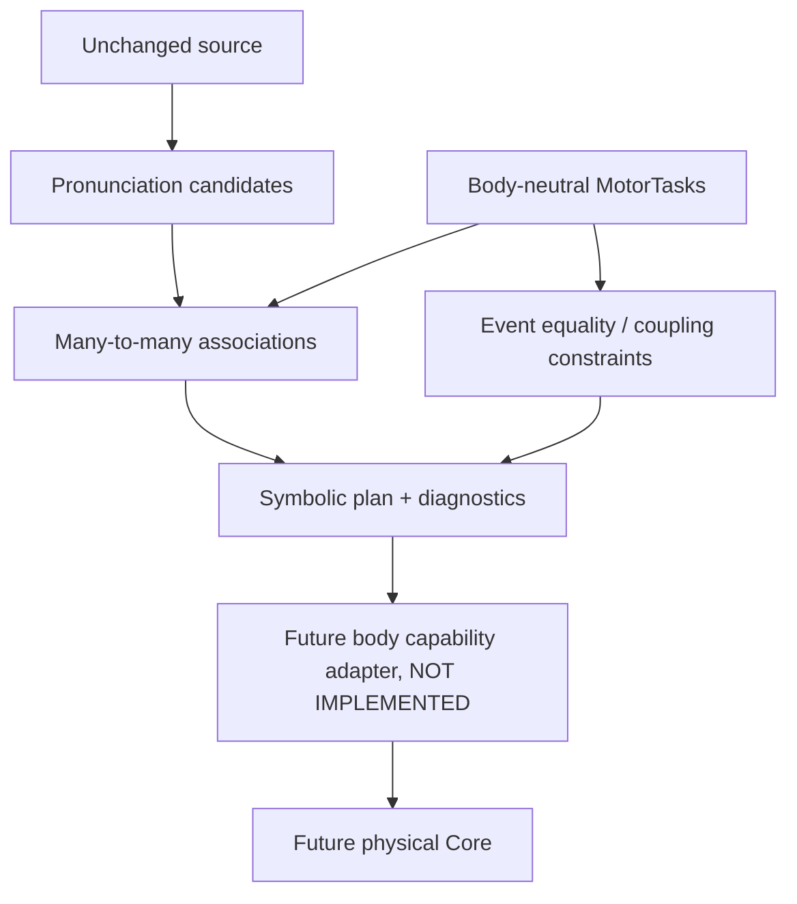

# SMC-3 SYSTEM — frozen research preregistration (Gate A, 2026-10-22)

## Research problem
The SMC-2 exploratory branch [PR #147](https://github.com/ryonakayama234/morphoacoustics/pull/147), exact HEAD `d12bddbbce2c5571f384217feec98bad3e487771` (code `a8e41fb65abd2aee5c19cc3fb413fa25370cea08`), creates a MotorIntentNode for each provisional phoneme. [Audit #148](https://github.com/ryonakayama234/morphoacoustics/issues/148) identifies lack of independent shared/multiple MotorTask IDs and separation of lexical edges from temporal coupling. Independent signoff remains pending.

## Hypothesis
A self-contained Python IR with `PronunciationUnit`, `MotorTask`, `TaskAssociation` and `CouplingConstraint` preserves non-duplicated many-to-many links and rejects invalid/contradictory symbolic graphs without importing Core, a physical solver, or Studio.

## Boundary diagram

## Design exclusions
No Japanese reading inference, automatic phoneme-to-task mapping, fixed one-phoneme-one-gesture guarantee, phonetic validity claim, organ geometry, physical `GestureScore`, pressure, F0, or waveform. A symbolically valid graph can still be physically impossible.

## Falsifiers
- Shared G2 must be duplicated or lost, or phoneme units cannot refer to >1 Task.
- Coupling interpreted as lexical ordering or overlap prohibited by source order.
- Contradictory exact equalities or dangling references return STRUCTURALLY_VALID.
- Package needs `morphoacoustics` or `morphoacoustics_graph` imports at runtime.
- Task structural validation returns a physical audio, actuation, or capability-ready claim.

## Engineering handoff
No files from draft PR #147 are auto-merged; reference the original SHAs. Document every tested change in SYSTEM/DATA/EXPERIMENTS/INDEX together. Gate A is implementer-origin freeze, not independent scientific preregistration. `main` is not an adoption target in this milestone.

## 2026-10-22 Gate B implementation receipt (not scientific adoption)
- Gate A preregistration commit: `4f7bef4a9709c96efaa80d8070a2d8b352d9b1d8` (preceded source implementation).
- Candidate symbolic IR source commit: `6b31e77365cf965931cb895286727bf75eaa9b57`.
- Standalone package is isolated from Core imports; implementation includes event anchors only for mathematically exact synthetic timing, not inferred phonetic events.
- Software tests, third-party reviewer, body adapter, perceptual experiments and scientific Gate remain independent. Current status: EXPLORATORY_IMPLEMENTED / VALIDATION_PENDING / NO_MAIN_MERGE.
