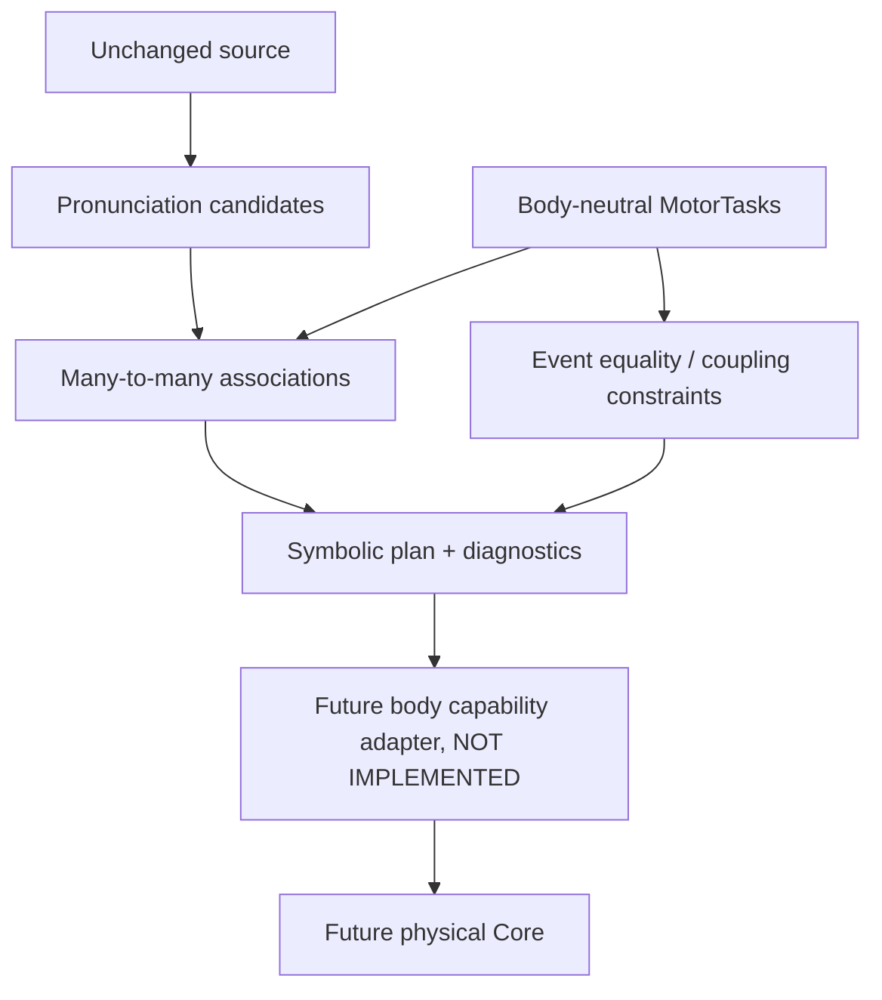

# SMC-3 SYSTEM — frozen research preregistration (Gate A, 2026-10-22)

## Research problem
The SMC-2 exploratory branch [PR #147](https://github.com/ryonakayama234/morphoacoustics/pull/147), exact HEAD `d12bddbbce2c5571f384217feec98bad3e487771` (code `a8e41fb65abd2aee5c19cc3fb413fa25370cea08`), creates a MotorIntentNode for each provisional phoneme. [Audit #148](https://github.com/ryonakayama234/morphoacoustics/issues/148) identifies lack of independent shared/multiple MotorTask IDs and separation of lexical edges from temporal coupling. Independent signoff remains pending.

## Hypothesis
A self-contained Python IR with `PronunciationUnit`, `MotorTask`, `TaskAssociation` and `CouplingConstraint` preserves non-duplicated many-to-many links and rejects invalid/contradictory symbolic graphs without importing Core, a physical solver, or Studio.

## Boundary diagram

## Design exclusions
No Japanese reading inference, automatic phoneme-to-task mapping, fixed one-phoneme-one-gesture guarantee, phonetic validity claim, organ geometry, physical `GestureScore`, pressure, F0, or waveform. A symbolically valid graph can still be physically impossible.

## Falsifiers
- Shared G2 must be duplicated or lost, or phoneme units cannot refer to >1 Task.
- Coupling interpreted as lexical ordering or overlap prohibited by source order.
- Contradictory exact equalities or dangling references return STRUCTURALLY_VALID.
- Package needs `morphoacoustics` or `morphoacoustics_graph` imports at runtime.
- Task structural validation returns a physical audio, actuation, or capability-ready claim.

## Engineering handoff
No files from draft PR #147 are auto-merged; reference the original SHAs. Document every tested change in SYSTEM/DATA/EXPERIMENTS/INDEX together. Gate A is implementer-origin freeze, not independent scientific preregistration. `main` is not an adoption target in this milestone.

## 2026-10-22 Gate B implementation receipt (not scientific adoption)
- Gate A preregistration commit: `4f7bef4a9709c96efaa80d8070a2d8b352d9b1d8` (preceded source implementation).
- Candidate symbolic IR source commit: `6b31e77365cf965931cb895286727bf75eaa9b57`.
- Standalone package is isolated from Core imports; implementation includes event anchors only for mathematically exact synthetic timing, not inferred phonetic events.
- Software tests, third-party reviewer, body adapter, perceptual experiments and scientific Gate remain independent. Current status: EXPLORATORY_IMPLEMENTED / VALIDATION_PENDING / NO_MAIN_MERGE.

### Implementation correction, same research branch
First CI run on `233bdbac18227a5b1dc974557b671f6b79578030`: all 21 synthetic pytest cases passed on Python 3.12, but strict mypy detected reused local loop variable typed first as `TaskAssociation` and later as `EventAnchor` in `validation.py`. Gate remains blocked until a new exact-HEAD rerun. Refactor uses distinct `anchor` local variable; this is a type-check correction only, no physical claim.

## 2026-10-22 verified software Gate B receipt (not research adoption)
Exact source HEAD **`9c9ac9539ae1798ed27ef5cd751562e4b2c9b469`**: GitHub API reported **16/16 completed check runs SUCCESS** (some duplicate push/PR runs), including isolated Python 3.11/3.12/3.13 package import/install + 21 synthetic pytest cases per run + strict package mypy, existing Core root test matrix/typecheck, and bounded SV1 regression. Evidence: [isolated package run](https://github.com/ryonakayama234/morphoacoustics/actions/runs/39777258873), [root tests](https://github.com/ryonakayama234/morphoacoustics/actions/runs/39777258910), [SV1](https://github.com/ryonakayama234/morphoacoustics/actions/runs/39777258867). An earlier failing mypy run is preserved in EXPERIMENTS. Individual OG3 and OG4 were not separately confirmed for this SHA. No independent reviewer, phonetic fixture, body adapter, wav or Studio integration. Disposition: **EXPLORATORY_SOFTWARE_PASS / SCIENCE_NOT_ADOPTED / NO_MAIN_MERGE**.

## 2026-10-23 Gate C — frozen adversarial software audit started
- **Frozen candidate**: PR #164 exact HEAD `7d5c405fee1b2469b11bbe6d68b9e0d18e4dab05`. Dedicated audit branch `research/smc3-gate-c-audit-20261023` branched from this SHA (not `main`). **Prior-to-test protocol** commit `7705ebd752e191a545506c0a2a79d56a40efc6bf`; see [GATE_C_PROTOCOL.md](GATE_C_PROTOCOL.md).
- Audited boundary: `PronunciationUnit` / `MotorTask` / many-to-many associations / rational `CouplingConstraint` -> symbolic diagnostics / timing. No body, Japanese reading inference, Studio code, physical audio, or phonetic claims.
- New tests treat the *original validator* as candidate under test. Construct event timestamps externally, add redundant rational cycles, exact contradictions, tuple permutations, absolute time shifts, incomplete components, invalid intervals, Unicode codepoint spans, and malformed runtime payloads.
- Audit written by the present implementation assistant: **adversarial implementer-origin, NOT independent third-party signoff**. Gate C remains unadopted; no merge.

## 2026-10-23 Gate C first red-run and bounded candidate correction

- Initial untouched candidate under adversarial tests: **`2a3a038c342150b37323a6c4b24cc846954d1c42`**. 100 constructive synthetic timing cases and metamorphic transformations reached passing assertions, but one explicit invalid-runtime-input case failed in standalone-package pytest; root matrix/typecheck and bounded SV1 checks succeeded. This is a software audit result, not phonetics.
- **BUG recorded before correction:** [PR #169 red-run receipt](https://github.com/ryonakayama234/morphoacoustics/pull/169#issuecomment-6367686236). `source_text=None` is rejected as `EMPTY_SOURCE` but a later codepoint span check called `len(None)`, raising `TypeError` instead of returning `INVALID`.
- **Subsequent fix commit `2de422883e544c1dff5ec12121a1f033a2f3afc5`**: compute `source_length` only for real strings, otherwise 0. Keep adversarial fixture and frozen protocol unchanged; no body, sound, Studio, schema, or main change.
- Post-fix exact HEAD CI and third-party design review are **separate gates**; do not interpret the patch itself as a pass. SCIENCE_NOT_ADOPTED.

## 2026-10-23 Gate C — verified exact-source-SHA repair CI

- **Fixed-source commit `2de422883e544c1dff5ec12121a1f033a2f3afc5`** is **16/16 completed SUCCESS**, zero failure/pending in GitHub check-runs API (two push/PR job sets): isolated package Python 3.11, 3.12, 3.13 pytest with 127 synthetic tests per interpreter, package strict mypy, existing root test matrix/typecheck, and bounded SV1. [Python 3.12 job](https://github.com/ryonakayama234/morphoacoustics/actions/runs/39973099897/job/120480625178). This is independent of the earlier red SHA `2a3a038c342150b37323a6c4b24cc846954d1c42`.
- Initial red failure **PRESERVED**, caused by `source_text=None` and unguarded `len(None)`; minimal source guard fixed the runtime fail-closed behavior with unchanged frozen test fixtures.
- All verified outcomes above refer to the **code-bearing SHA `2de422883e544c1dff5ec12121a1f033a2f3afc5`**, not automatically to later documentation-only commits. Document-only final branch HEAD checks require their own confirmation. OG3 and OG4 were not run as separate exact-SHA science gates by these package-scoped actions; do not claim them.
- Disposition: **GATE_C_IMPLEMENTER_ORIGIN_SOFTWARE_PASS / HUMAN_INDEPENDENT_REVIEW_PENDING / SCIENCE_NOT_ADOPTED / NO_MAIN_MERGE**. This is not a physical or phonetic validation.

## 2026-10-24 Codex-reviewed software boundary extension

See [GATE_C_CODEX_REVIEW.md](GATE_C_CODEX_REVIEW.md). Original implementation PR #164 received **two Codex P2 software findings** at SHA `7d5c405fee1b2469b11bbe6d68b9e0d18e4dab05`: malformed Unicode scalar data could be accepted then break the UTF-8 research receipt, and inconsistent anchors could cause input-order-dependent follow-on diagnostics. This is an independently executed **AI code review**, not human or scientific validation.

The first post-review regression commit `08e2a47c8fd34017b6a52cacaef3485779515617` failed 8 fixture invocations before any new validator patch. Separate fix `a3f876fcaef3b63e2612807fab288a7e36e7e54a` rejects surrogate code points across caller strings used in the receipt and suppresses time/duration derivations when equalities conflict. Its exact code SHA passed **16/16** GitHub check-runs, including package tests/mypy on 3.11–3.13. Fresh Codex review and final documentation-HEAD CI are separate future receipts. No physical semantics, no Studio, no main merge.
